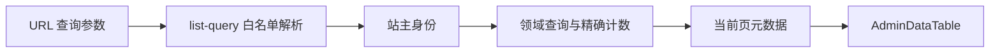

# 系统模块与数据边界

一个部署服务一个 OPC。站点身份、商业配置和导航从数据库读取，访客主题偏好只属于浏览器。当前模块组织借鉴成熟模板的职责划分，继续使用本项目既有发布、交易和权限体系。

## 内容与公开输出

`src/lib/content-kinds.ts` 维护专辑类型、路由与可售能力。普通专辑、手册、技能、活动复用 series / chapter；活动和技能的扩展数据保持专用。新增类型必须同步导入、发布重验、检索引用、机器输出与测试，未知类型不能默认跳到另一个类型。

公开阅读使用会话 RLS 和服务端授权；元数据、SEO、sitemap 与机器目录只读取公开投影。付费正文只在授权路径读取，不进入导航、列表、SEO 或未授权分身上下文。普通专辑在机器协议里保持 series，支付仍是 series SKU。

## 后台查询

`admin_documents` 将文章和导入文件/最新修订合并为逻辑文档；同文档同时保留线上状态与修订状态，不创建新的业务状态。该视图与 `admin_collections` 使用 security_invoker 并显式验证站主，依赖底层 RLS。

`admin_user_directory` 是读取 Auth 邮箱的窄服务端聚合，仅 service_role 可执行；应用必须先验证站主。它不返回凭据、正文或任意表。概览指标独立加载，其他页面不读取全站看板。

主列表先授权、筛选、计数，再分页；默认 20，可选 50/100，附唯一键排序。单个对象明细才读取正文、消息或履约信息。CSV 导出是单独的完整读取，不作为列表查询方式。

## 默认内容

`content/starter/manifest.json` 明确列出可用公共文档。`starter:build` 生成固定 JSON 与摘要；运行时不扫描仓库，也不接触环境文件、内部归档或开发记录。

站主动作预留草稿父专辑、独立页和章节元数据，再逐章调用现有发布管线。专用事务包装将发布重放与进度检查点同时提交；同一请求不增加版本，已有修改或 slug 冲突停止。整套完成后才公开父专辑和方案导航；升级不自动导入或覆盖站主内容。`starter_imports` 是操作检查点，不属于内容复用导出。

`cp-pricing` / `cp-subscribe` 是白名单组件，HTML 保存和读取均净化。服务端渲染方案时读取当前价格、开关和权威购买入口，不从 HTML 接受订单金额。

## 主题与导航

`tokens.json → tokens:build → tokens.css` 是唯一 token 生成链，原始设计导出仅作来源。next-themes 在首屏使用 class，默认跟随系统；系统字体、实体底色回退与减少动态效果规则适用于全站。Hero 自己的文字明暗独立于全局主题。

AppShell 组合桌面三栏、平板图标栏和手机底栏。后台另用分组导航。普通专辑和独立页的可见导航按名称/排序合并；草稿与归档不进导航，暂停保留阅读。导航隐藏不授予或撤销阅读权利。

## AI 调用

分身、Skill、页面生成和知识库通过共享 `generate`／`embed` 调用 AI SDK Core 及直接供应商适配器。SDK 的自定义 fetch 只能经 `transport` 访问当前连接的固定目标；请求次数、期限和容量由项目强制限制。内容权限、任务指令、索引代际、会话及用量账本仍由业务服务管理，不托管到 SDK 的默认环境。协议与维护入口见 [AI SDK 接入说明](ai-sdk-migration.md)。

## 数据库与发布

追加迁移维护结构，生成 install / verify 与清单，不修改已发布迁移。新装保持两个 SQL 入口；已有实例使用[升级指南](../operations/database-upgrade.md)。迁移不会自动配置云端 Storage、Auth 或调度。

数据库、RLS 和支付的最终审查独立于日常实现。隔离浏览器夹具、PGlite 权限测试、真实 PostgreSQL 连接竞争与陌生部署者验收各有边界，不能相互替代。回滚应用必须兼容 collection，保留内容、订单、权益及检查点。
